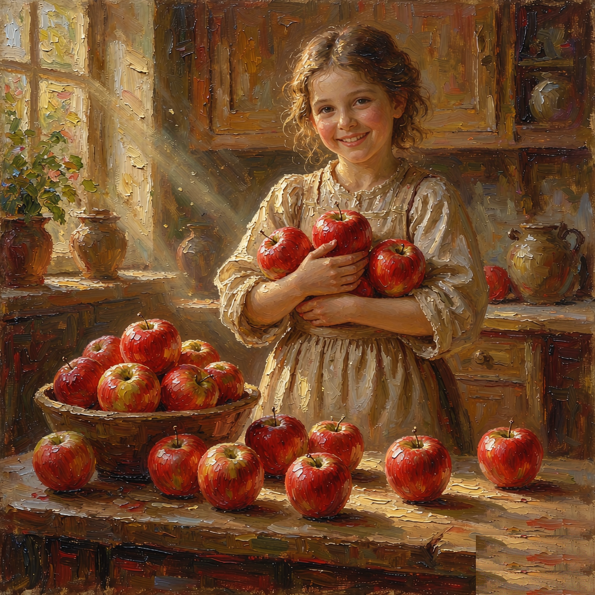
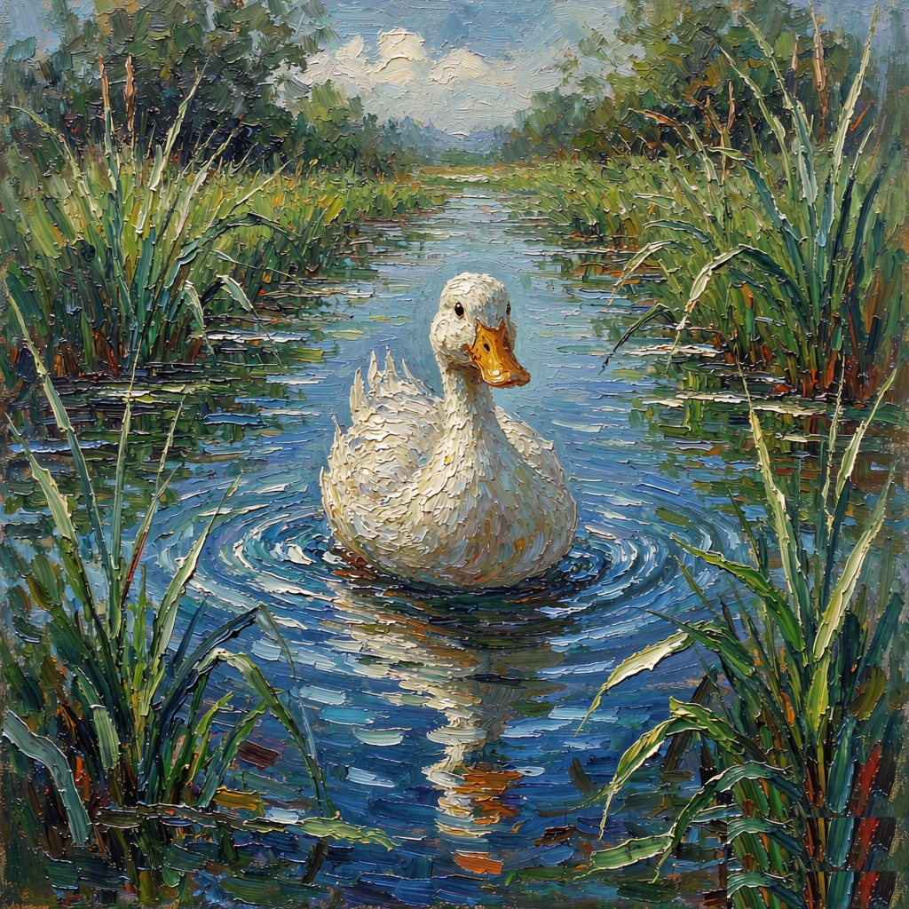

# single-word-card · 单词油画卡 Skill

一词一张精美单词卡，配图为 AI 生成的**油画质感无文字底图** + **确定性文字叠加**——所有文字（单词/IPA/中文/例句/同类词）100% 来自词表，零出错。

## 卡片版式（7 段）

黄粗外框 → 单词大字（深蓝白描边）→ 音标浅蓝框（🔊 + IPA）→ 中文浅绿框 → 油画大插图 → 例句紫虚线框（关键词标红 + 中文译）→ 同类词扩展紫虚线框（3 个小图卡）

## Demo 配图（油画底图，已去水印）

三张验证卡的无文字油画底图（`demo/` 目录）：女孩抱多个苹果体现 `some` 的复数语义、海边看船对应 `sea`、水中白鸭对应 `duck`。

| some | sea | duck |
|:---:|:---:|:---:|
|  |  |  |

## 与 flashcard skill 的分工

| | flashcard（场景卡） | 本 skill（单词卡） |
|---|---|---|
| 卡型 | 3–5 词塞进一张场景图，标签连线指物 | **1 词 1 卡**，大插图 + 例句 + 同类词扩展 |
| 配图 | 扁平插画场景 | **油画质感**（impasto 厚涂、色彩饱满） |
| 适用 | 词汇量大的主题归类教学 | 单词精讲、例句、拓展联想 |

## 文件结构

```
SKILL.md                            # 8 步流水线（词义构图→油画底图→逐张验收→去水印→组装→截图自检→交付）
references/semantic-composition.md  # 语义构图硬规则：some 必须多对象、动作词画瞬间、抽象词具象隐喻
references/card-template.html       # 7 段版式 HTML 模板（改 CARDS 数组即换词表）
scripts/repair_watermark.py         # 纹理克隆去水印（去 ImageGen 右下角固定水印，油画安全）
demo/                               # 三张验证卡油画底图（some / sea / duck）
```

## 快速用法

把词表（`word | ipa | 中文 | 例句 | 译 | 同类词×3`）丢给装有本 skill 的 Agent，说「用 single-word-card 出卡」即可按流水线批量产出。

## 核心设计

1. **语义构图**：配图 prompt 必须先编码词义要点（数量/动作/关系），避免「形对意错」——画面漂亮但 `some` 只画一个苹果。
2. **确定性文字**：AI 只画无文字底图，文字全部由 HTML 模板确定性渲染。
3. **纹理克隆去水印**：克隆水印区上方纹理 + 微抖动，比纯色覆盖更适合油画等非均匀背景。

---
License: MIT
